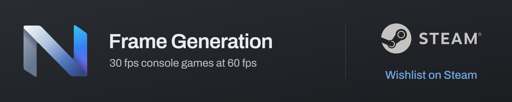
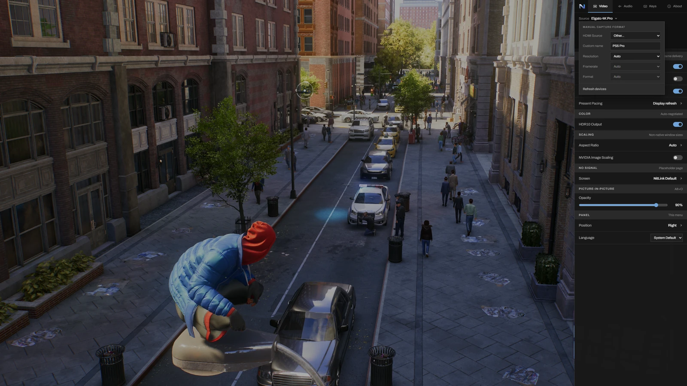
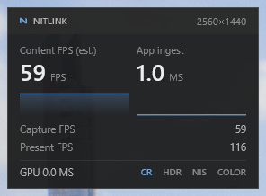

<p align="center">
  
</p>

# NitLink

A capture card viewer for playing your console in a Windows desktop window. Keep your PC workflow, native HDR10 and VRR, with a preview built for low latency.

**Official NitLink repository.**

Built and tested on the Elgato 4K Pro (PCIe), 4K S (USB), 4K X (USB), and Cam Link 4K (USB).

**[Download NitLink](https://github.com/nitlink-dev/nitlink/releases/latest)** · **[Wishlist on Steam](https://store.steampowered.com/app/5346980)** · [Hardware support](#hardware-support) · [Report an issue](https://github.com/nitlink-dev/nitlink/issues)

<p align="center">
  <a href="https://github.com/nitlink-dev/nitlink/releases/latest"></a>
  <a href="https://github.com/nitlink-dev/nitlink/releases"></a>
  <a href="LICENSE"></a>
  
</p>

## Official downloads and Steam

Download the current NitLink release from [GitHub Releases](https://github.com/nitlink-dev/nitlink/releases/latest). The source in this repository is MIT-licensed and continues to be maintained.

[NitLink on Steam](https://store.steampowered.com/app/5346980) is coming soon with experimental frame generation inside the normal, resizable NitLink window. It targets **30 fps SDR games displayed at 60 fps**, using intermediate frames generated on the PC GPU. Frame generation adds delay and does not change the console game's own frame rate or input response.

The frame-generation engine and trained models are developed separately and are not included in this repository. See the Steam page for GPU requirements and availability. The capture, HDR and VRR documentation below describes the source distributed here.

<p align="center">
  <a href="https://store.steampowered.com/app/5346980"></a>
</p>

[Watch the NitLink showcase](https://youtu.be/w8Rq5Bonbgg) · [View the HDR comparison](docs/images/COMPARSIONS.webp)

---

## Why

NitLink started with a PS5 and a 42-inch PC monitor. I wanted to play in a window I could Alt-Tab to, keep the game's HDR picture, take screenshots and use Discord alongside it. That became the focus: a capture preview designed for playing, with native HDR10, source-aware presentation and low latency.

---

## Is this for you?

NitLink fits a setup where you want to:

- Play your console in a window alongside your PC apps, without switching monitor inputs.
- Preserve HDR10 on an HDR-capable display, with compatible capture hardware.
- Use source-aware pacing on a VRR display, plus screenshots, scaling and routed game audio.

A PC, a capture card and a supported HDMI source are required. Direct HDMI to a monitor or TV remains the simplest path when you have a dedicated display. For recording or streaming, run OBS alongside NitLink.

---

## What it does

- **Native HDR10 capture and output.** On supported hardware, NitLink requests 10-bit P010 capture, interprets BT.2020/PQ video and presents HDR10 on an HDR-capable display with Windows HDR enabled. Source detection, negotiated capture format and the HDR output preference remain separate. Card-side tone mapping is selected to match the capture path; `Alt+R` provides an Auto / Full / Limited range override.
- **Low-latency preview with published measurements.** Low-Latency mode is on by default. Same-system tests against Elgato 4K Capture Utility showed lower measured latency on the 4K Pro and 4K S and a statistical tie on the 4K X. These are measurements of the listed setups. VSync is controlled separately with `Alt+V`; enable it if tearing is visible. See [Performance](#performance).
- **Presentation pacing for captured content.** A 30 fps game can arrive from a capture card as 60 frames per second with repeats. **Display refresh** presents on the render loop, subject to VSync and the present cap. **Capture rate** presents once per delivered capture. **Source frame rate** uses image comparisons to estimate unique-picture cadence and holds the learned cadence on still images. It can help compatible VRR displays and external frame-generation tools follow captured content. It is an estimate of picture changes; noisy repeated frames and subtle motion can affect classification. Source pacing adds readback work and may add delay. Select the mode in F1 or through `present_pacing` in `nitlink.json`.
- **Live source detection in the title bar.** On supported Elgato cards NitLink reads the HDMI source identifier, resolution, fps, and HDR state straight from the card's vendor protocol and shows them in the window title (e.g. `NitLink - PlayStation 5 [HDR]` or `NitLink - 3840x2160 @ 60Hz [HDR]`), updating live as the source changes.
- **True-HDR screenshots.** `Ctrl+S` saves a shareable tonemapped SDR `.png` and, when capturing HDR, a true-HDR `.jxr` (scRGB FP16) sidecar that opens as real HDR in the Windows Photos app.
- **MJP-style Catmull-Rom resampling** with an anti-ringing clamp for scaled capture video.
- **NIS upscaling**: NVIDIA Image Scaling integrated as a compute-shader pass for sharpening at non-native window sizes.
- **HDR-aware HUD overlay**: Content FPS (estimated) is the main number and sparkline, with Capture FPS and successful Present FPS underneath. Static content can measure 0; unavailable estimation shows `--`. Capture includes duplicates, Content estimates pixel changes rather than game FPS, and Present counts submissions rather than display scanout. Composited correctly into the HDR backbuffer at 203-nit paper-white so it doesn't blow out against HDR content.
- **WASAPI audio routing** with volume + mute.
- **Borderless fullscreen** and **picture-in-picture**.
- **Prevent sleep while playing.** Enabled by default while captured video is visible, including paused games. Releases when minimized, hidden, showing No signal or closed. Turn off **Prevent sleep** in F1 to keep normal Windows idle sleep behavior. Windows power settings are not changed; manual sleep and policy-enforced screen locking remain available.
- **Discord Rich Presence** showing playing NitLink. Uses Discord's local IPC pipe only; NitLink itself makes no network connections.
- **Multi-device source picker.** Live capture-device list in the F1 settings sidebar. Click a connected device to switch without restarting; the selection persists. Generic devices remain SDR-only unless they have an explicit capture policy, such as the GC553Pro native P010/HDR path.
- **Smart signal handling.** Brief HDMI handshake windows (PS5 boot logo, source switch, SDR ↔ HDR transitions) keep showing the last good frame instead of the card's NO SIGNAL placeholder. Real signal loss is detected by format-tagged content fingerprints with a temporal-stability gate.

<p align="center">
  
</p>

<p align="center">
  <em>F1 source menu: custom HDMI source name, capture resolution, frame rate and format.</em>
</p>

---

## Performance

NitLink was tested back-to-back against Elgato 4K Capture Utility on one RTX 5080 / LG C3 OLED system. In that run, it measured lower latency on the 4K Pro and 4K S and was statistically tied on the 4K X. Each viewer pair used the same card, source mode, display and sensor position, with medians from 100 samples.

| Card / source mode | NitLink | Elgato | Difference |
|---|---|---|---|
| 4K Pro @ 1080p144 | **38.4 ms** | 44.2 ms | NitLink -5.9 ms |
| 4K X @ 4K120 | **47.7 ms** | 48.4 ms | Statistical tie (-0.8 ms, within noise) |
| 4K S @ 4K60 | **67.8 ms** | 75.1 ms | NitLink -7.3 ms |

These historical measurements use NitLink 1.1 with Low-Latency mode and a tearing-allowed present capped at 117 Hz on a 120 Hz VRR panel. They do not measure the current release or built-in frame generation. Differences are calculated from the unrounded medians.

Absolute values include the rig's trigger and source path and depend on the test setup. They are not controller-to-screen gameplay latency or a ranking of the capture cards, which used different source modes. The full configuration, methodology and raw data are in [docs/LATENCY.md](docs/LATENCY.md).

Low-Latency mode controls where NitLink waits in the presentation path. VSync controls synchronization and is toggled separately with `Alt+V`. Tearing-allowed presentation can tear; compatible VRR behavior depends on the display, presentation mode and driver. VSync can remove the visible split and may add delay.

A direct HDMI connection avoids the capture and viewer stages. The measured comparisons show the difference between two viewers on the same rig; they do not establish equivalence to direct HDMI or to a different gaming setup.

<p align="center">
  
</p>

<p align="center">
  <em>Ctrl+F3 HUD captured during Spider-Man gameplay. Estimated Content FPS leads, with Capture FPS and successful Present FPS underneath. App ingest is part of the pipeline delay; these counters do not measure monitor scanout.</em>
</p>

---

### Tested platforms

| Platform | GPU / CPU | Display | Cards |
|---|---|---|---|
| Desktop | RTX 5080, Windows 11 | LG C3 OLED 42" @ 4K 120Hz, G-Sync VRR | 4K Pro, 4K S, 4K X, Cam Link 4K |
| Acer Nitro 5 (AN515-54) | RTX 2060, i7-9750H | TUF VG289Q 4K IPS @60Hz, FreeSync HDR10 | 4K S |

---

## Known limitations

- **Elgato 4K S: 1080p HDR or 4K SDR, not both.** Its USB 3.2 Gen 1 (5 Gbps) interface can't fit 4K@60 P010 (HDR10, ~12 Gbps). The driver only publishes P010 at 1080p/720p. Elgato lists 4K60 SDR capture via MJPEG and native 4K NV12 at up to 30 fps; negotiated viewer output can be converted by Media Foundation. Hardware ceiling, not a NitLink limitation. See [Elgato's format table](https://www.elgato.com/us/en/explorer/products/capture/4k-s-supported-resolutions-and-frame-rates/).
- **Elgato 4K S: HDR costs resolution.** Engaging HDR clamps capture to 1080p, so `hdr_enabled` acts as opt-in even with an HDR source connected. `Alt+H` flips between 1080p HDR and 4K SDR at runtime.
- **Elgato 4K X: the current 4K HDR policy is limited to 30 fps.** NitLink caps 4K P010 requests at 30 Hz and uses SDR NV12 for its 4K120 path. The source format, USB connection and driver determine the modes that can be negotiated. NitLink keeps the card's HDR-to-SDR conversion on for that path, so an HDR console still shows a clean SDR picture; the F1 capture line reads P010 when real HDR is being delivered. HDR at 120 Hz fits at 1080p.
- **AVerMedia GC553Pro HDR depends on native P010 modes.** With Auto capture format and `hdr_auto_from_source` enabled (the default), NitLink reads HDMI source state through the card's UVC extension unit and selects P010 for confirmed HDR10/PQ or NV12 for SDR. Manual formats and the `Alt+H` output preference remain independent. Failed probes retain the last valid source state; until detection succeeds, the existing P010/HDR-to-SDR fallback is preserved. P010 modes come exclusively from Media Foundation enumeration, and unavailable requests fall back to a native mode with a notice. Manual 1920x1080@60 P010 was validated on Windows 11, and the contributor supplied GC553Pro validation for the later fixes. Broader automatic native-mode fallback selection has not been fully validated on GC553Pro hardware.
- **Windows HDR can be temperamental.** Moving the window across monitors with different HDR profiles, some notification overlays, or apps with custom ICC profiles can cause flickering/desaturation. Closing and reopening NitLink resets its swap chain. The cause of a particular occurrence needs investigation; these symptoms alone do not identify a Windows-wide defect.
- **VRR depends on the display and presentation path.** A compatible display alone does not guarantee variable refresh at every content rate. Low-rate behavior depends on the display, driver and presentation settings.
- **Tearing on fixed-refresh displays.** Enable VSync with `Alt+V` or F1 to synchronize presentation. VSync defaults to off and may add input delay. Leave Low-Latency enabled; `Alt+L` does not control VSync. GPU driver overrides still apply: use the application-controlled VSync setting in the driver to follow the NitLink toggle.
- **Brief visual artifact during PS5 HDR mode changes.** Changing the PS5's HDR setting mid-session renegotiates the HDMI link; a frame or two can show a transient green band before the next reconcile (~100ms). Restarting NitLink avoids it if you know you'll change PS5 HDR mode.
- **Spider-Man 2 on the 4K S in 4K SDR (game-specific).** On the 4K S's NV12 4K@60 SDR path the estimated Content FPS counter reads lower than expected for this title, while other games on the same setup run at 60fps. Switching the 4K S to 1080p HDR restored 60fps in that test. The cause is unconfirmed; a source/card interaction is a hypothesis.
- **Built-in frame generation is in development for [NitLink on Steam](https://store.steampowered.com/app/5346980).** It is not included in the source or GitHub release documented here. For recording or streaming, capture the NitLink window in OBS.

<p align="center">
  
</p>

<p align="center">
  <em>Branded no-signal screen, shown after the grace window expires.</em>
</p>

---

## Troubleshooting

- **No audio at all.** Windows has a device-wide Microphone access switch (Settings, Privacy & security, Microphone) that also blocks capture-card audio for desktop apps. NitLink shows a notice when it hits that denial; turn the switch on and restart NitLink.
- **A 120 Hz source captures at 1080p on the 4K Pro.** The card passes 4K120 through to the display but captures 4K only at 60 Hz, so with a 120 Hz source it offers 1080p120. A softer picture at 120 Hz is the card's ceiling, not a NitLink setting. Set the console to 60 Hz for 4K capture, or use a 4K X, which captures 4K120.
- **HDR looks flat or washed out.** NitLink renders real HDR10 only while Windows HDR is on for the display. Turn it on in Windows display settings before pressing Alt+H.
- **Surround sound.** Every Elgato capture device delivers stereo PCM to the PC; Dolby, DTS, and multichannel LPCM are not forwarded by the card, so NitLink can only play two channels. Set the console to Linear PCM, 2.0 channels, so the center channel is not lost in the card's downmix.
- **The picture is squeezed or stretched.** Some cards deliver 4:3 sources inside a 16:9 frame. Press Alt+A to cycle the aspect ratio, or set `aspect_ratio` in nitlink.json.

---

## Download

Get `NitLink-<version>-win64.zip` from the [official GitHub Releases page](https://github.com/nitlink-dev/nitlink/releases/latest), extract the complete ZIP into a folder you can write to, and run `NitLink.exe`. Keep the bundled files and folders together. Settings are saved in the working directory, normally next to the executable.

Official NitLink channels are **[GitHub Releases](https://github.com/nitlink-dev/nitlink/releases/latest)** and **[NitLink on Steam](https://store.steampowered.com/app/5346980)**, maintained by Klosed Lab. Forks and community builds are maintained separately. For support with one of those builds, use its maintainer's support channel and include the build name and version.

The executable is not code-signed yet, so Windows may show a SmartScreen warning. Verify the official download before choosing **More info**, then **Run anyway**.

---

## Requirements

- Windows 10 (1809+) or Windows 11
- DirectX 11 capable GPU
- Current Microsoft Edge WebView2 Evergreen runtime (preinstalled on Windows 11). An outdated WebView2 runtime with updates blocked may lack required security interfaces; NitLink reports this and keeps the capture picture visible.
- For HDR: an HDR-capable display + HDR enabled in Windows display settings
- For VRR: a compatible display (G-Sync / FreeSync / HDMI 2.1 VRR) with VRR enabled at the OS and display level
- A supported capture card (see [Hardware support](#hardware-support))

### LG OLED notes

On an LG OLED, set the HDMI input icon to "Game Console" (not "PC") for correct HDR Game mode. For VRR, enable G-Sync VRR under `Settings → General → Game Optimizer → VRR & G-Sync`; the Game Dashboard shows "G-SYNC VRR" and the live refresh rate NitLink is driving.

---

## Hardware support

| Device | Status |
|---|---|
| Elgato 4K Pro (PCIe) | ✅ Tested and validated. 4K@60 HDR10 + VRR, HDR auto-detect + source mode via `IKsPropertySet`. |
| Elgato 4K S (USB) | ✅ Tested and validated. 4K@60 SDR (NV12) or 1080p@60 HDR10 (P010). Source name + HDR detect via vendor HID. |
| Elgato 4K X (USB) | Capture tested. Source details use the UVC extension unit. The 1440p60 HDR reconciliation correction is awaiting hardware validation; see [#36](https://github.com/nitlink-dev/nitlink/issues/36). |
| Elgato Cam Link 4K (USB) | ✅ Validated (generic UVC, SDR, no vendor controls). |
| Elgato Game Capture 4K60 Pro MK.2 (PCIe) | ✅ Verified by an owner. HDR auto-detect works and colors match Elgato Studio. |
| AVerMedia Live Gamer ULTRA S GC553Pro (USB) | ✅ Manual 1920x1080@60 P010 HDR validated on Windows 11, with later hardware validation supplied by the contributor. Auto capture follows confirmed HDR10/PQ or SDR source state through the UVC extension unit; native P010 modes come from Media Foundation. Broader automatic fallback selection still needs hardware validation. |
| Other Elgato / AVerMedia / Magewell / Razer | ❓ Untested — generic Media Foundation capture should still work. |

NitLink uses Media Foundation for its main capture path. Other Media Foundation-compatible devices can use generic SDR capture, subject to their available formats and drivers. Elgato-specific HDR and source controls apply only to supported cards. An optional DirectShow backend is also available.

If you have a different card and want official support, open an issue with: card model, OS version, what you saw, and the `[NitLink/Formats]` lines from the Debug Output window.

---

## Build

CMake and Visual Studio 2022 or later with the Desktop C++ workload. Also install the C++ ATL for x86 and x64 component matching the selected MSVC toolset (Visual Studio Installer > Individual components); GC553Pro source detection uses its headers. Tested with Visual Studio 2022 / 2026 Insiders.

```
git clone https://github.com/nitlink-dev/nitlink
cd nitlink
```

In Visual Studio: `File → Open → CMake...`, pick `CMakeLists.txt`, select `x64-Release`, `Build → Build All`.

Or CLI (Developer Command Prompt):
```
cmake -B build -G "Visual Studio 17 2022" -A x64
cmake --build build --config Release
```

Output at `out/build/x64-Release/NitLink.exe` (VS) or `build/Release/NitLink.exe` (CLI). The build copies `nitlink-menu.html`, `locales/en-US.js`, `locales/zh-TW.js`, `locales/zh-CN.js`, `locales/de-DE.js`, `locales/ko-KR.js`, the complete `assets/menu` folder and `third_party/nis/NIS_Scaler.h` beside the `.exe`, preserving their subfolders (all are needed at runtime).

---

## Hotkeys

| Key | Action |
|---|---|
| `F1` | Open / close settings menu |
| `Alt + V` | **VSync** on/off (default: off; saves the preference) |
| `Alt + L` | **Low-Latency** present on/off (default: on; off adds up to one refresh of lag) |
| `Alt + H` | Toggle HDR output; capture format follows the source and card policy |
| `Alt + R` | Cycle source color range: Auto → Full → Limited |
| `Alt + A` | Cycle aspect ratio: Auto → 4:3 → 16:9 → 16:10 → 21:9 → Stretch |
| `F11` or `Alt + Enter` | Toggle fullscreen |
| `Alt + O` | Toggle picture-in-picture |
| `Alt + Up / Down` | Scale PiP up / down, preserving its shape (20 px of width per step, `Shift` for 80 px) |
| `Alt + Left / Right` | Decrease / increase PiP opacity by 5 percentage points (`Shift` for 10 points) |
| `Ctrl + Arrow keys` | Nudge PiP by 20 px (hold `Shift` for 80 px) |
| `Ctrl + Alt + Left / Right` | Decrease / increase PiP width by 20 px (hold `Shift` for 80 px) |
| `Ctrl + Alt + Up / Down` | Decrease / increase PiP height by 20 px (hold `Shift` for 80 px) |
| `Ctrl + S` | Save screenshot (SDR `.png` + true-HDR `.jxr`) to `Pictures/NitLink/` |
| `Ctrl + F3` | Toggle HUD overlay (remembered between launches) |

HUD visibility follows `show_overlay` in `nitlink.json` (default: `false`). Toggling it with `Ctrl + F3` saves the choice immediately.

With PiP active, **drag a corner to scale both dimensions together**, preserving the window's current shape. Drag an edge to adjust just its width or height. The pointer changes to a resize cursor near the edges.

PiP movement, resizing, scaling, and opacity shortcuts can be tapped for one step or held to repeat (after a short delay). Resizing keeps the window within its current monitor's work area, with width limited to 80-16384 px and height to 45-16384 px (or the work area size, if smaller). Set opacity from 10% to 100% with the shortcuts or the **F1 → Video → Picture-in-picture → Opacity** slider. The slider also sets the opacity for the next time PiP opens. Size, position, and opacity are saved to `nitlink.json` on exit.

**Advanced / diagnostic:**

| Key | Action |
|---|---|
| `Ctrl + F4` | HDR color-fidelity test patches (A/B against a reference) |
| `Ctrl + F6` | HDR levels readout (live luma/chroma code range — verify color range per card) |

On the 4K Pro / 4K X, Auto capture follows the detected source HDR state; the HDR output toggle remains a separate preference. On the 4K S, source HDR state is auto-detected but the HDR pipeline is opt-in (it costs resolution); `Alt+H` flips both renderer HDR and capture format at runtime. On the GC553Pro, Auto capture follows confirmed HDR10/PQ or SDR source state when `hdr_auto_from_source` is enabled; `Alt+H` changes the output preference independently, and a manually selected capture format remains pinned.

---

## Configuration

Settings live in `nitlink.json` in the working directory (normally next to the executable; a shortcut can set a different Start in folder). Plain text; auto-saves on every toggle. If loading fails, saves stop to protect the original file; F1 shows the warning and names a recovery backup when one could be created. Identical rejected content reuses a backup; up to two copies of at most 1 MiB are kept as `.bak` and `.bak.1`. Larger rejected files remain untouched without being copied. Correct or rename the file and restart to resume saving. An unwritable folder or file also produces a warning. A leftover `.save-recovery` copy does not prevent loading or normal saves; the warning gives its full path. Identical copies are deleted silently, and a successful save is not treated as failed if cleanup is temporarily blocked. If both an in-place write and restoration fail, further saves stop for that session and the warning explains how to recover the file. Config warnings appear as timed toasts and stay available in F1; they are omitted from NitLink screenshots. Numeric values accept a leading number followed by text (for example, `117 Hz` or `1920.0`), while finite-value and range checks still apply. Keys of interest:

- `vsync`: synchronize presentation (default `false`). Toggle with `Alt+V` or F1; the setting survives restart and graphics-device recovery. VSync bypasses the tearing-mode present cap, including `VRR_CAP.txt`, and may add input delay. Driver overrides still apply.
- `low_latency`: low-latency present mode (default `true`). `true` = present-on-arrival (lowest input lag). `false` = the frame is held after capture and the swap-chain wait moves before present, so the picture is up to one refresh older. VSync controls tearing separately; `false` can add input lag. Toggle with `Alt+L` or the F1 panel.
- `hdr_enabled`: HDR output preference. On the 4K Pro / 4K X, Auto capture can remain P010 for an HDR source while HDR output is off; the viewer then tone-maps to SDR. On the 4K S, the preference also selects the HDR capture path, which clamps capture to 1080p. Manual capture formats and device-specific fallback policies still apply.
- `present_pacing`: `refresh` (default) presents on the render loop, subject to VSync and the present cap. `captured` presents once per delivered capture. `unique` estimates unique-picture cadence and retains the learned cadence on still images. Source pacing adds comparison/readback work and may add delay; content classification remains an estimate. Both paced modes bypass the present cap. An older `vrr_present_pacing = true` preference is migrated to `unique`.

- `present_cap_hz`: present-rate cap in Hz for display-refresh pacing (default `0` = automatic: monitor refresh minus 3 when that accommodates the source frame rate, otherwise monitor refresh). Uses the window monitor's DisplayConfig rational rate without rounding fractional modes. An unavailable or ambiguous display query uses an explicit 30 Hz software fallback, which can reduce preview smoothness; it is not a measured refresh rate. Applies with Low-Latency on or off. `30` to `1000` = fixed cap, `-1` = explicitly uncapped. VSync and source/capture pacing bypass it; `VRR_CAP.txt` overrides the configured rate.

- `aspect_ratio`: `auto` (default, the ratio the card reports), `stretch` (fill the window), or a fixed ratio such as `4:3`, `16:9`, `16:10`, `21:9`. Restores 4:3 sources that a card delivers stretched inside a 16:9 frame. Cycle with `Alt+A` or from the F1 panel.
- `no_signal_mode`: `default` (NitLink's branded page) or `image`. With `image`, choose a local PNG, JPEG/JPG, or BMP from the F1 **No Signal** section. `no_signal_image` is stored as UTF-8; `no_signal_fit` accepts `contain`, `cover`, or `stretch`, and `no_signal_dim_image` controls the optional 40% black dim layer (`true` by default). The image keeps its intrinsic aspect ratio, remains independent of the normal capture `aspect_ratio`, and is decoded into a cache instead of being read from disk every frame. Custom No Signal images must be on a local drive; UNC shares and mapped network drives are unsupported. Large photos are scaled to a bounded pixel buffer. Files above 512 MiB or 16384 pixels per side produce a visible size warning. GIF, WebP, TIFF, and HEIC are unsupported. With no image selected, the branded screen stays visible.
- `panel_side`: `right` (default), `left`, or `full`. Right and left open the F1 panel as a strip beside the picture, which keeps playing underneath. Full covers the window with the wide layout. `panel_width` is the docked width in device-independent pixels (default `420`). Cycle the position from the panel's Video tab.
- `nis_enabled` / `nis_sharpness` / `nis_scale_mode`: NIS upscaler config.
- `color_expansion`: limited-to-full SDR RGB range expansion (default off). The control appears under F1 > Video > Advanced only for RGB capture with SDR output and limited source range. HDR output, full-range input, NV12 and P010 bypass this setting; the saved preference is retained.
- `audio_volume` / `audio_muted`: playback level.

---

## Architecture

Pure DirectX 11. Capture frames arrive via Media Foundation on a worker thread into a triple-buffered frame queue, then run through the render pipeline:

```
PS5 HDMI
  ▼
Elgato card (hardware tonemap disabled when supported; source info read via vendor protocol)
  ▼
Media Foundation  (P010 for HDR10, NV12 for SDR; row order + nominal range detected)
  ▼
GPU upload (DYNAMIC texture)
  ▼
GPU frame differ (640x360 SAD) classifies unique vs duplicate  → gates Present in Source frame rate pacing
  ▼
Capture shader  (P010 → BT.2020-PQ passthrough; NV12/BGRA → Catmull-Rom + range-aware decode)
  ▼
Optional NIS upscale (compute shader)
  ▼
HUD / settings overlay composite (203-nit paper-white when HDR)
  ▼
DXGI flip-discard waitable swap chain  (R10G10B10A2 + HDR10 PQ when HDR; BGRA8 when SDR;
  SetMaximumFrameLatency(1), ALLOW_TEARING; present-on-arrival in low-latency mode)
  ▼
Display (VRR depends on compatible hardware and presentation settings)
```

The settings menu is HTML/CSS in an embedded WebView2 child window; C++ ↔ JS over `window.chrome.webview.postMessage`.

---

## Project layout

```
src/
├── main.cpp           : WinMain, COM/MF init
├── app/               : Application, config, WebView2 settings bridge, game database
├── audio/             : WASAPI audio routing
├── capture/           : MF device, frame buffer, Elgato HDR/source control, frame differ, DShow backend
├── discord/           : Discord RPC client
├── input/             : Global hotkey manager
├── overlay/           : D2D HUD overlay + branded no-signal screen
├── renderer/          : DX11 swap chain, shaders, window
├── ui/                : Theme tokens
└── upscale/           : NIS upscaler integration

third_party/           : NIS, WebView2, WIL
```

---

## Scope

NitLink does one thing: makes your console feel like part of your PC. Not a recording or streaming tool — run OBS alongside it for that.

---

## License

The NitLink source in this repository is MIT licensed. See [`LICENSE`](LICENSE). Third-party licenses (NIS, WebView2, WIL, MJP's Catmull-Rom) are in [`LICENSES.md`](LICENSES.md).

The Steam frame-generation engine and trained models are developed separately and are not distributed in this repository.

---

## Acknowledgments

- **Matt Pettineo (TheRealMJP)**: Catmull-Rom bicubic reference. MIT licensed.
- **NVIDIA**: NIS SDK.
- **Microsoft**: WIL, WebView2.
- **Brandon (13bm), [elgato4k-linux](https://github.com/13bm/elgato4k-linux)**: Elgato HID/protocol reference. See [`ACKNOWLEDGMENTS.md`](ACKNOWLEDGMENTS.md).
- **Testing & feedback**: u/Lordmau5, u/XSilverlink, and u/TooxChilly for hardware testing, bug reports, and cross-card latency measurements.
- **Hardware**: u/elgato_phil (Elgato) provided the 4K X and the Cam Link 4K used for validation.
- **Traditional Chinese (zh-TW) localization**: [HolyBear（聖小熊）](https://github.com/HolyBearTW) (`@HolyBearTW`) for translation review and real-device validation.
- **Simplified Chinese (zh-CN) localization**: [CN_115](https://github.com/CN115) (`@CN115`).
- **German (de-DE) localization**: [Noka123](https://github.com/Noka123) (`@Noka123`).
- **Korean (ko-KR) localization**: [iorph](https://github.com/i0rph) (`@i0rph`) for translation and real-device localization review.
- See [ACKNOWLEDGMENTS.md](ACKNOWLEDGMENTS.md) for the full contributor and research credits.

---

## Support development

NitLink is created and maintained by Klosed Lab ([nitlink-dev](https://github.com/nitlink-dev)), with community contributions to code, translations and hardware validation. Donations fund hardware testing and distribution. Current goals:

- **Code-signing certificate.** Sign release binaries and identify the publisher in Windows. SmartScreen behavior also depends on file and certificate reputation.
- **Broader capture-card validation.** Extend the tested Media Foundation format policies beyond the currently validated Elgato devices and AVerMedia GC553Pro.

Support at [ko-fi.com/klosed89](https://ko-fi.com/klosed89). The source in this repository is MIT-licensed. Official releases and support remain linked from this repository.

Bug reports and PRs welcome.

---

*NitLink is an independent software application. It is not affiliated with, authorized, sponsored, or endorsed by Corsair Gaming, Inc., Elgato Systems LLC, or their affiliates. All registered trademarks, including "Elgato", "4K Pro", "4K X", "4K S", and "Cam Link", are the property of their respective owners.*
